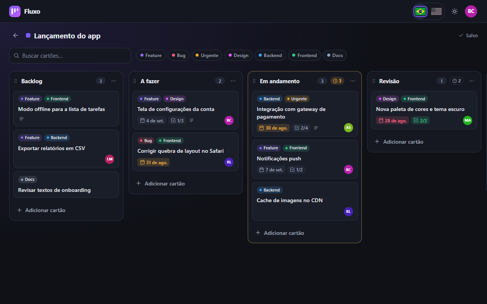

# Fluxo | Kanban board with Angular 20 + NgRx

[Português](README.md) · **English**

A complete Kanban board built with **Angular 20 (standalone)**, **NgRx** (Store, Effects, Entity,
Router Store, DevTools) and **Angular CDK Drag and Drop**. It has a fake JWT login, boards with
draggable columns and cards, **optimistic updates with rollback** when the server fails, card
details with a checklist, filters, per-column WIP limits, a dark theme and a UI in **Portuguese and
English**. The backend is a fake REST API (`angular-in-memory-web-api`) behind `HttpClient`, so the
whole app runs as a static site and can switch to a real API without touching the components.

**Demo:** https://portfolio.brunoisaac.dev/angular-kanban-board/ (sign in with any e-mail and a
password with 6+ characters, or click "Fill in a demo account").



## Highlights

- **Auth**: fake login returning a JWT (8 h expiry) stored in `localStorage`, route guard, bearer
  token interceptor, logout and automatic sign-out on 401.
- **Boards, columns and cards**: create, rename, recolor, delete; set WIP limits; reorder columns
  and drag cards between columns. Every change is applied immediately and persisted by an effect;
  if the server fails the previous state is restored and a toast explains what happened.
- **Card details** (lazy-loaded dialog): title, description, labels, due date, assignee initials,
  column and a checklist with a progress bar.
- **Filters** by text (accent-insensitive) and labels; **WIP warnings** per column.
- **Demo mode**: the user menu can make every write fail (to watch the rollbacks) or restore the
  sample data.
- **Responsive and accessible**: horizontal column scrolling with snap on phones, touch dragging,
  skip link, focus styles, ARIA labels, live regions, reduced motion support.

## Stack

Angular 20.3 · NgRx 20.1 · Angular CDK 20.2 · Transloco 8.4 + transloco-locale · angular-in-memory-web-api
0.20 · TypeScript 5.9 · RxJS 7.8 · ESLint 9 + angular-eslint 20 · Prettier 3 · Karma + Jasmine (95
tests) · GitHub Actions + Cloudflare (Workers static assets).

## Architecture in short

- `core/` (auth, layout, theme, notifications, i18n), `shared/` (UI and utilities), `features/`
  (`auth`, `boards`, each with `pages/`, `components/`, `data-access/`, `models/`) and `mock-api/`.
- Everything is lazy: the authenticated shell, every page, the card dialog, and the feature NgRx
  state/effects (`provideState`/`provideEffects` in the `boards` route providers).
- Optimistic writes carry the `previous` value; failure actions restore it. Moves use `concatMap`,
  creations `mergeMap`, loading `switchMap`, login `exhaustMap`.
- Pure, unit-tested helpers for reordering, filtering, WIP and due dates.

## Internationalization

- Transloco with global strings in `public/i18n/<lang>.json` and **lazy scopes per feature**
  (`public/i18n/auth/…`, `public/i18n/boards/…`) registered with `provideTranslocoScope` in each
  feature route.
- Initial language: saved choice (`kanban.lang`) > browser language (`pt*` → pt-BR, otherwise en)
  > pt-BR. `<html lang>` follows the active language; the header and login screen have an accessible flag switcher (inline SVG flags in a radio group).
- Dates are formatted with `@jsverse/transloco-locale` (Intl). Route titles are translation keys
  resolved by a custom `TitleStrategy`. The store keeps error **keys**, not text.
- To add a language: create the three JSON files with the same keys and add it to
  `SUPPORTED_LANGS`, `LANG_TO_LOCALE`, `LANG_NATIVE_NAMES` and `LANG_FLAGS` in
  `core/i18n/language.ts` (plus its flag in `shared/ui/flag`). A spec checks that every language
  has exactly the same keys.

## Running it

```bash
npm install
npm start            # http://localhost:4200
npm run test:ci      # unit tests in headless Chrome
npm run lint         # ESLint
npm run build        # production build
npm run build:cf     # production build with base href /angular-kanban-board/
```

## Deploy

Published on Cloudflare (Workers static assets) at
https://portfolio.brunoisaac.dev/angular-kanban-board/ by the pipeline of the
[portfolio](https://github.com/BrunoICosta/portfolio) repository, which runs `npm run build:cf` and
serves `dist/angular-kanban-board/browser`. SPA fallback is handled by a Worker; this repository
only runs CI (lint, tests and build).

## Author

**Bruno Vinicius Isaac Costa** · https://github.com/BrunoICosta · [MIT license](LICENSE)
