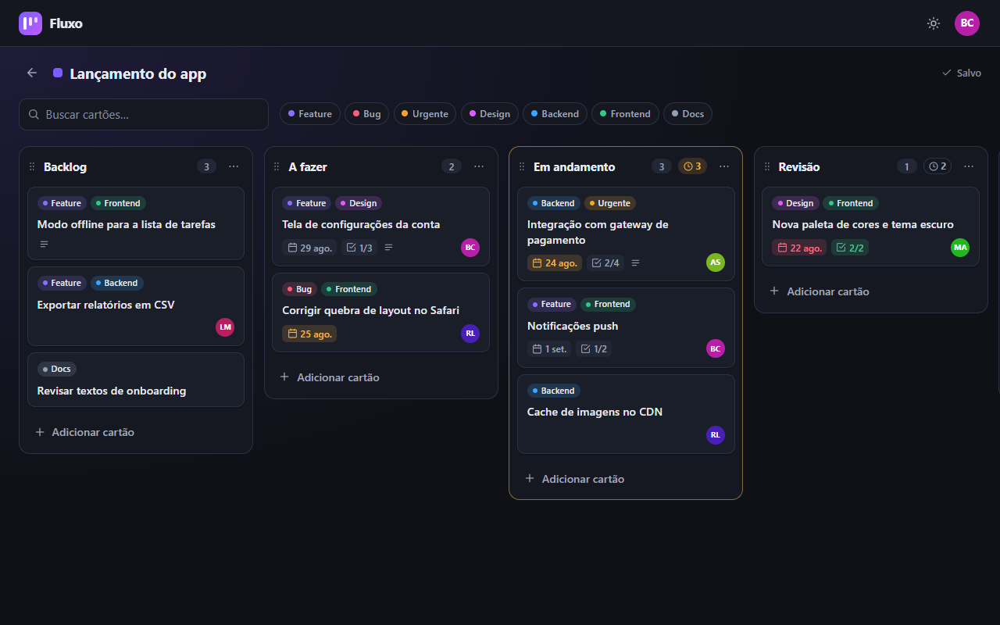

# Fluxo — Quadro Kanban com Angular 20 + NgRx

Quadro Kanban completo feito com **Angular 20 (standalone)**, **NgRx** (Store, Effects, Entity,
Router Store e DevTools) e **Angular CDK Drag and Drop**. Tem login simulado com JWT, quadros com
colunas e cartões que podem ser arrastados, **atualização otimista com rollback** quando o servidor
falha, detalhes do cartão com checklist, filtros, limite de WIP por coluna e tema escuro. O backend
é uma API REST falsa (`angular-in-memory-web-api`) acessada via `HttpClient`, então o projeto roda
inteiro no GitHub Pages e pode trocar para uma API real sem mexer nos componentes.

**Demo:** https://brunoicosta.github.io/angular-kanban-board/
(entre com qualquer e-mail e uma senha com 6+ caracteres — ou clique em "Preencher com conta de
demonstração").



## Funcionalidades

- **Autenticação simulada**: login com qualquer e-mail + senha de no mínimo 6 caracteres; a "API"
  devolve um JWT (header.payload.assinatura falsa) com expiração de 8 h, salvo no `localStorage`.
  Guard de rota, interceptor que adiciona `Authorization: Bearer …`, logout e redirecionamento
  automático quando a API responde 401 (sessão expirada).
- **Quadros**: criar, renomear, trocar a cor e excluir (com confirmação). Estados de carregamento
  (skeleton), vazio e erro com "tentar novamente".
- **Colunas**: adicionar, renomear, definir limite de WIP, excluir e **reordenar arrastando pelo
  cabeçalho** (ou pelo menu "mover para a esquerda/direita", acessível por teclado).
- **Cartões**: criação rápida na coluna, **arrastar entre colunas e reordenar**. Toda mudança é
  aplicada na hora (otimista) e persistida por um effect; se o servidor falhar, o estado anterior é
  restaurado e um aviso aparece.
- **Detalhes do cartão** (dialog carregado sob demanda): título, descrição, etiquetas, prazo
  (destacado quando atrasado ou perto de vencer), responsável com avatar de iniciais, mudança de
  coluna e **checklist com barra de progresso**.
- **Filtros**: busca por texto (sem diferenciar acentos/maiúsculas, com debounce) e por etiquetas,
  com contador "x de y cartões". O arraste é pausado enquanto um filtro está ativo.
- **Limite de WIP**: a coluna fica âmbar no limite e vermelha acima dele, com aviso e notificação
  ao arrastar um cartão que estoura o limite (limite "soft", como no Kanban).
- **Modo demonstração**: no menu do usuário dá para **simular falhas do servidor** (todas as
  escritas retornam 503, ótimo para ver o rollback) e restaurar os dados de exemplo. Indicador
  "Salvando… / Salvo" no topo do quadro.
- **Responsivo e acessível**: colunas com rolagem horizontal e snap no celular, arraste com toque
  (pressionar e segurar), skip link, foco visível, labels/ARIA, `aria-live` para notificações,
  `prefers-reduced-motion`. Tema escuro por padrão e tema claro opcional (persistido).

## Stack

| Camada | Tecnologia |
| --- | --- |
| Framework | Angular 20.3 (standalone, signals, control flow, `input()/output()/model()`) — CLI 20.3.32 |
| Estado | NgRx 20.1 — Store, Effects, Entity, Router Store, Store DevTools |
| UI | Angular CDK 20.2 — Drag and Drop, Dialog, Menu, Overlay; SCSS com design tokens |
| Backend falso | angular-in-memory-web-api 0.20 (atrás do `HttpClient`) |
| Linguagem | TypeScript 5.9 (strict) + RxJS 7.8 |
| Qualidade | ESLint 9 + angular-eslint 20.7 (regras de acessibilidade), Prettier 3 |
| Testes | Karma 6 + Jasmine 5 (ChromeHeadless) — 81 testes |
| CI/CD | GitHub Actions (lint, testes, build) + deploy no GitHub Pages |

## Arquitetura e decisões

- **Pastas por responsabilidade**: `core/` (singletons: autenticação, layout, tema, notificações),
  `shared/` (componentes de UI e utilitários sem regra de negócio), `features/` (cada feature com
  `pages/`, `components/`, `data-access/` e `models/`) e `mock-api/` (o "servidor" falso, isolado
  do app).
- **Lazy loading em tudo**: `app.routes.ts` só declara `loadChildren`/`loadComponent`. Até o shell
  autenticado (header, menus, toasts) é lazy, porque a tela de login não precisa dele. O dialog de
  detalhes do cartão é importado dinamicamente na primeira abertura. Chunks gerados pelo build:

  | Chunk lazy | Tamanho (raw) |
  | --- | --- |
  | `login-page-component` | ~9 kB |
  | `shell-component` | ~9 kB |
  | `boards-routes` (state + effects + API da feature) | ~6 kB |
  | `boards-list-page-component` | ~13 kB |
  | `board-page-component` (inclui CDK Drag and Drop) | ~95 kB |
  | `card-detail-dialog-component` | ~13 kB |

  Bundle inicial: ~395 kB raw / ~116 kB transferidos.
- **NgRx por feature**: o estado de quadros, colunas, cartões e UI do quadro é registrado com
  `provideState`/`provideEffects` nos `providers` da rota `boards`, então só é carregado junto com
  o chunk. Só o slice `auth` e o `router` são globais.
- **Entity adapters** para quadros, colunas e cartões (ordenados por `position`), e seletores
  memoizados para agrupar cartões por coluna, aplicar filtros e calcular o resumo.
- **Atualização otimista + rollback**: cada escrita é uma ação de página (`Board Page`) que já
  carrega o "antes" (`previous`). O reducer aplica a mudança imediatamente; o effect persiste e
  emite `… Success` ou `… Failure`; no failure o reducer restaura o `previous` e um effect mostra
  o aviso. Movimentos usam `concatMap` (ordem garantida), criações `mergeMap`, carregamento
  `switchMap` e login `exhaustMap`.
- **Lógica pura e testável**: a reordenação (`moveCard`, `reorderColumns`), filtros, WIP, prazos e
  progresso da checklist são funções puras em `data-access/utils`, fáceis de testar sem TestBed.
- **IDs no cliente** (`crypto.randomUUID`) permitem criar entidades otimisticamente antes da
  resposta do servidor.
- **Backend falso atrás do HttpClient**: `angular-in-memory-web-api` substitui o `HttpBackend`, então
  interceptors, erros e efeitos são os mesmos de uma API real. Ele valida o token em todas as
  rotas, faz exclusão em cascata, filtra por igualdade (`?boardId=`) e persiste no `localStorage`.
  Um interceptor normaliza os erros dele para `HttpErrorResponse`. Para usar uma API real, basta
  remover `provideMockApi()` e ajustar o token `API_BASE_URL`.
- **Componentes OnPush + signals**: `selectSignal` nos componentes, `input()/output()/model()`,
  `computed()`, formulários reativos tipados e nada de `CommonModule`.

## Como rodar

Pré-requisitos: Node 22 e npm 10.

```bash
npm install
npm start            # http://localhost:4200
```

```bash
npm test             # Karma em modo watch
npm run test:ci      # testes uma vez em Chrome headless
npm run lint         # ESLint (TS + templates)
npm run format:check # Prettier
npm run build        # build de produção em dist/
npm run build:pages  # build com base-href do GitHub Pages
```

Dica: instale a extensão Redux DevTools para acompanhar as ações (`Board Page`, `Board API`, …) e
usar time-travel.

## Estrutura de pastas

```
src/app/
├── app.component.ts, app.config.ts, app.routes.ts
├── core/
│   ├── api/            # API_BASE_URL, tradução de erros HTTP
│   ├── auth/           # guard, interceptor, JWT, sessão, store (actions/reducer/effects)
│   ├── demo/           # configurações do modo demonstração
│   ├── layout/         # shell autenticado + header
│   ├── notifications/  # serviço de toasts + container
│   ├── store/          # tipo do estado raiz
│   └── theme/          # tema escuro/claro
├── features/
│   ├── auth/           # auth.routes.ts + pages/login-page
│   └── boards/
│       ├── boards.routes.ts        # rotas + provideState/provideEffects da feature
│       ├── pages/                  # boards-list, board-page
│       ├── components/             # coluna, cartão, dialogs, toolbar, checklist…
│       ├── data-access/
│       │   ├── api/                # clientes REST (boards, columns, cards)
│       │   ├── store/              # boards/ e board-detail/ (entity + effects + selectors)
│       │   └── utils/              # reorder, filtros, WIP, checklist
│       ├── models/
│       └── testing/                # fixtures para os testes
├── mock-api/           # angular-in-memory-web-api: endpoints, seed e JWT falso
└── shared/
    ├── ui/             # ícones, avatar, empty state, confirm dialog, inline form
    └── utils/          # datas, iniciais, ids
```

## Próximos passos

- Backend real (NestJS ou .NET) com endpoint de movimentação em lote e autenticação de verdade.
- Sincronização em tempo real entre usuários (WebSocket) e resolução de conflitos.
- Reordenação acessível de cartões só com teclado e anúncios de leitor de tela durante o arraste.
- Migrar para zoneless e Signal Forms quando o projeto for atualizado para Angular 21+.
- Testes end-to-end (Playwright) cobrindo os fluxos de arraste.

## Autor

**Bruno Vinicius Isaac Costa** — https://github.com/BrunoICosta

Licença [MIT](LICENSE).
